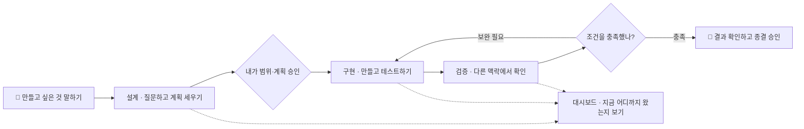
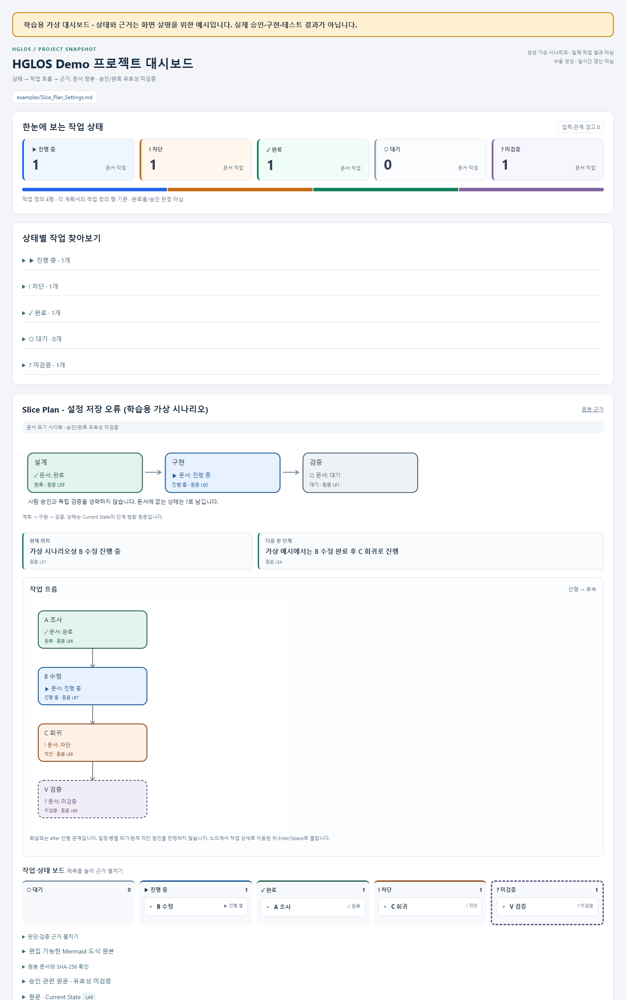

# HGLOS

**AI에게 계획을 세우고, 구현하고, 독립된 맥락에서 검증하게 하는 5개 스킬입니다.**
Codex·Claude Code·Antigravity에서 같은 계획서와 근거를 이어 씁니다. 사람은 범위·계획·최종 종결을 승인합니다.

## 이렇게 사용합니다



**사람이 방향과 승인을 맡고, AI가 계획·구현·확인을 맡습니다.**
막히면 구현을 보완하고 다시 검증합니다. 대시보드는 현재 위치와 남은 일을 보여줍니다.

## 바로 시작

로컬 프로젝트를 열 수 있는 **Codex 앱/CLI 또는 Claude Code**에 로그인하세요.
일반 ChatGPT·Claude 웹 채팅에 아래 명령을 붙이는 방식은 아닙니다.
Git과 Python 3.10+가 필요하며 Python 추가 패키지·API 키는 필요 없습니다.
터미널에서 먼저 확인합니다.

```powershell
git --version
python --version
```

Windows에서 `python`이 안 되면 `py -3 --version`을 확인하고 아래 명령의 `python`을 전부 `py -3`로 바꾸세요.
둘 다 안 되면 [Python](https://www.python.org/downloads/)을 설치하고 터미널을 다시 엽니다.
실제 실행 파일을 직접 지정할 수도 있습니다: PowerShell에서는 `& "C:/경로/python.exe" tools/install_skills.py ...`.
macOS/Linux에서 `python3`만 있으면 `python3`로 바꿉니다.

**설치 명령은 내려받은 `hglos` 폴더에서, AI 실행은 내 작업 프로젝트에서 합니다.**
`D:/my-project`는 **이미 존재하는 Git 프로젝트의 루트 폴더**로 바꾸세요.

```powershell
git clone https://github.com/nothing2that-sys/hglos.git
cd hglos
```

작업 폴더가 없다면 먼저 아래 연습용 폴더를 만드세요. 마지막에 출력된 절대 경로로 이후 명령의 `D:/my-project`를 바꿉니다.

```powershell
# hglos 폴더에서 실행 (연습용 프로젝트가 필요한 경우만)
New-Item -ItemType Directory -Force -Path ../hglos-demo
git -C ../hglos-demo init
Resolve-Path ../hglos-demo
```

위 폴더 준비 예시는 Windows PowerShell용입니다. macOS/Linux에서는 `mkdir -p ../hglos-demo`와 `git -C ../hglos-demo init`으로 준비한 뒤 해당 폴더의 절대 경로를 사용하세요.
기존 프로젝트도 Git 저장소가 아니면 그 폴더에서 `git init`으로 시작합니다.
설치 대상이 맞는지 `git -C "D:/my-project" rev-parse --show-toplevel`로 확인하세요.

대상 폴더를 준비했으면, `hglos` 폴더에서 필요한 호스트에 설치합니다.

```powershell
# Codex에 설치
python tools/install_skills.py --target codex --project "D:/my-project"

# Claude Code에 설치 (둘 다 쓰면 둘 다 실행)
python tools/install_skills.py --target claude --project "D:/my-project"
```

Codex 앱에서는 **설치 대상 프로젝트**를 열고 새 대화를 시작합니다.
CLI에서는 새 터미널에서 `cd "D:/my-project"` 후 `codex` 또는 `claude`를 실행합니다.
`hglos` 배포 저장소에서 그대로 AI를 시작하면 다른 폴더에서 작업하게 됩니다.
Codex는 `.agents/skills/`, Claude는 `.claude/skills/`에 설치됩니다.
미리보기는 `--dry-run`, 모든 프로젝트에서 쓰려면 `--project ...` 대신 `--user`를 붙입니다.

**첫 호출 확인**: Codex에는 아래 한 줄, Claude Code에는 `$`를 `/`로 바꿔 입력하세요.

```text
$hglos-design 설치 확인부터 해줘. 현재 프로젝트를 확인하고 만들고 싶은 것과 작업 범위를 질문해줘. 아직 승인하지 않았으니 구현하지 마.
```

현재 프로젝트와 목표·범위를 확인하는 질문이 나오면 설계 시작 단계입니다.
스킬을 찾지 못하면 설치 대상·새 대화 여부를 확인하세요. 같은 이름의 사용자 스킬이 있다면 함께 확인합니다.
이름만 인식한 것과 실제 스킬 파일을 읽은 것은 다르므로 사용한 `SKILL.md` 경로를 물어보면 구분할 수 있습니다.

아래는 실제 작업 순서입니다. **처음부터 구현·검증 행을 차례로 실행하지 마세요.**

| 순서 | Codex에 붙여넣기 | Claude Code에 붙여넣기 |
|---|---|---|
| 계획 | `$hglos-design 설정 저장 오류를 고칠 계획을 세워줘. 범위와 계획 승인에서 멈춰줘.` | `/hglos-design 설정 저장 오류를 고칠 계획을 세워줘. 범위와 계획 승인에서 멈춰줘.` |
| 구현 | `$hglos-implement 승인된 doc/Slice_Plan_Settings.md를 구현하고 테스트해줘. 커밋은 하지 마.` | `/hglos-implement 승인된 doc/Slice_Plan_Settings.md를 구현하고 테스트해줘. 커밋은 하지 마.` |
| 검증 | `$hglos-verify 모드 B로 doc/Slice_Plan_Settings.md의 종결 조건을 검증해줘. 소스 수정·커밋 금지.` | `/hglos-verify 모드 B로 doc/Slice_Plan_Settings.md의 종결 조건을 검증해줘. 소스 수정·커밋 금지.` |

경로는 실제 생성된 계획서로 바꾸고 단계마다 새 대화에서 시작합니다.
미달이면 보완하고 최종 종결·커밋은 사용자가 결정합니다.

**[설치·업데이트·문제 해결](docs/USER_GUIDE.md)** · **[복사해서 쓰는 예시](examples/README.md)** · **[동작 원리](docs/HOW_IT_WORKS.md)**

## 대시보드 예제

[](examples/dashboard/index.html)

**[예제 HTML](examples/dashboard/index.html)** · **[예제 입력 계획서](examples/Slice_Plan_Settings.md)**

클론한 폴더의 `examples/dashboard/index.html`을 더블클릭하면 브라우저에서 열립니다.
GitHub에서는 HTML 소스가 보이므로 내려받은 파일을 여세요. 서버 설치는 필요 없습니다.
위 화면은 **가상 예시**이며 실제 코드·장비가 검증됐다는 뜻이 아닙니다.

내 계획서로 만들려면 `hglos` 폴더에서 아래 명령을 실행합니다. `--repo`는 내 프로젝트 루트,
`--plan`과 `--output`은 그 프로젝트 기준 상대 경로입니다.

```powershell
python plugin/hglos/skills/hglos-dashboard/scripts/dashboard.py --repo "D:/my-project" --plan doc/Slice_Plan_Settings.md --output validation/dashboard.html
```

## 어떤 일을 하나요?

| 스킬 | 역할 |
|---|---|
| `hglos-design` | 요구사항 질문 → 범위 승인 → 검증 가능한 계획서 → 계획 승인 |
| `hglos-implement` | 승인·변경 범위 확인 → 구현 → 테스트·보고서 |
| `hglos-verify` | 모드 A: Git 변경분 검토 / 모드 B: 계획의 종결 조건 대조 |
| `hglos-dashboard` | 계획과 근거를 HTML·Markdown 현황판으로 표시 |
| `hglos-coordinate` | 같은 폴더의 여러 세션이 쓰기 범위를 예약하고 결과를 인계 |

Claude plugin 방식도 지원합니다. 위 개별 스킬 설치와 **한 방식만 선택**하세요.

```text
/plugin marketplace add nothing2that-sys/hglos
/plugin install hglos@hglos
```

plugin은 `/hglos:hglos-design`처럼 호출합니다. 자동 hooks는 별도 선택 설정입니다.
스킬 설치가 독립 검증·권한 강제·실제 장비 시험을 대신하지는 않습니다.

<details>
<summary>개발·내용 확인 도구</summary>

업데이트는 `--upgrade --dry-run`으로 미리 확인한 뒤 `--upgrade`로 실행합니다.
기존 스킬은 백업 후 교체하며 `Backup:`에 위치를 출력합니다.
복구에 실패해 `restore incomplete`가 나오면 표시된 항목과 백업 위치로 직접 복구하세요.

```powershell
python -m unittest discover -s tests
python tools/package_skill.py
python tools/package_public_source.py
python tools/build_demo_dashboard.py
python -B plugin/hglos/scripts/context_index.py build --layout source --root plugin/hglos --task verify
```

설치본은 `--layout installed --root <개별-스킬>`을 사용합니다.
`check`의 `--expect-index-sha256`는 외부 해시를 대조하는 선택 옵션입니다.
인덱스 일치는 승인·모델 이해의 증거가 아닙니다. [공통 진입](plugin/hglos/ENTRY.md)을 참고하세요.

</details>

English: Install with `--target codex` or `--target claude`, then ask the design, implement, and verify skills in fresh chats. Approve scope and plan before implementation. Guides and skill instructions are primarily Korean.

[MIT License](LICENSE) · [배포·출처 안내](THIRD-PARTY-NOTICES.md)
