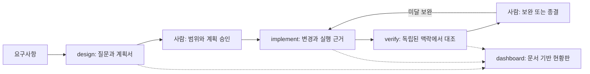

# HGLOS 동작 원리

HGLOS는 `SKILL.md` 지침, Markdown 템플릿, Python 표준 라이브러리 도구를 묶습니다.
모델은 지침을 읽고 호스트 도구로 조사·편집·검증합니다. 별도 서버나 데몬이 단계를 자동 실행하지 않습니다.

계획서가 세 단계의 공통 기준입니다. 지시서와 보고서는 실제 변경·실행 결과를 연결합니다.
검증자는 구현자 보고를 사실로 전제하지 않습니다. 최종 승인·커밋은 사용자·프로젝트 지침에 따릅니다.

| 파일·도구 | 책임 |
|---|---|
| `plugin/hglos/ENTRY.md` | 작업별 공통 규칙·스킬·참조 안내 |
| `RULES.md`, `HOST.md` | 사람 승인·독립성·호스트 기능과 한계 |
| `skills/hglos-*/SKILL.md`, `assets/` | 단계별 절차와 계획서·지시서·보고서 템플릿 |
| `scripts/plan_hash.py` | 계획 내용의 변경 대조 |
| `scripts/check_parallel.py` | 쓰기 범위·공유 자원·의존성 검사 |
| `scripts/set_diff.py`, `stale_ids.py` | 기대/실제 목록 대조·오래된 참조 후보 검사 |
| `skills/hglos-dashboard/scripts/` | HTML·Markdown·SVG·Mermaid 현황 출력 |
| `scripts/coordination*.py` | 세션 등록·선점·충돌·인계 메타데이터 |
| `tools/install_skills.py` | 공통 문서·스크립트를 포함한 독립 스킬 설치 |

원본은 `plugin/hglos/`입니다. 이전 공개 버전의 `plugins/`, `shared/`, `dist/` 구조를 대체하며 marketplace는 현재 원본을 가리킵니다.
`tools/package_skill.py`는 `skill/`에 독립 스킬·통합 번들을 생성합니다.

승인·계획 해시는 변경을 추적하는 기준입니다. SHA-256 일치가 승인·모델 이해·정확성을 증명하지는 않습니다.
`context_index.py`는 읽을 자료의 목차·내용 식별 도구이며 호스트 전체 지침 검사의 대체물이 아닙니다.

coordination을 활성화하면 협조하는 세션이 편집 전 쓰기 범위를 선점하고 충돌 시 대기합니다.
메타데이터는 `.hglos/`에, hook가 실행할 고정 사본은 `.hglos/bin/`에 둡니다.
외부 편집기나 hook를 따르지 않는 프로그램까지 강제로 막지 않습니다. 인계 해시는 전달 후 변경 여부를 확인합니다.

도구 실행 성공, 인용 확인, 테스트 통과, 실제 장비 시험, 사람 승인은 서로 다른 근거입니다.
실측이 없는 조건은 미검증·측정 불가로 남기며 테스트 수를 완성도로 해석하지 않습니다.

공개 소스에는 명시 allowlist의 코드·문서·합성 테스트만 포함합니다.
개인 경로가 있는 개발 기록·세션 원문·인증 설정·내부 개발 Git 이력은 제외합니다.
